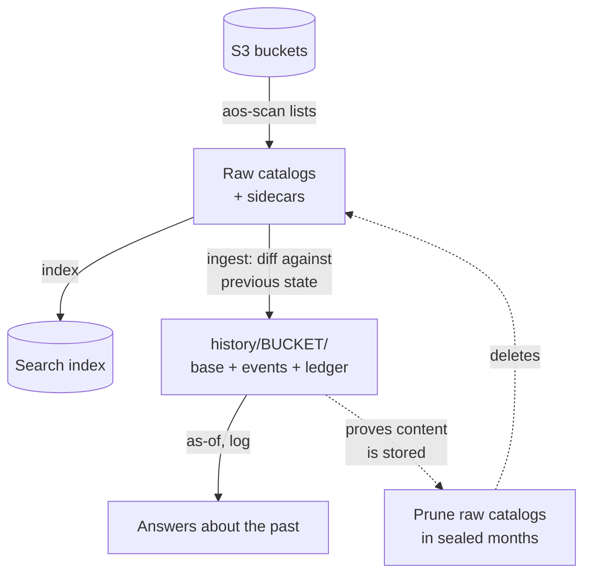
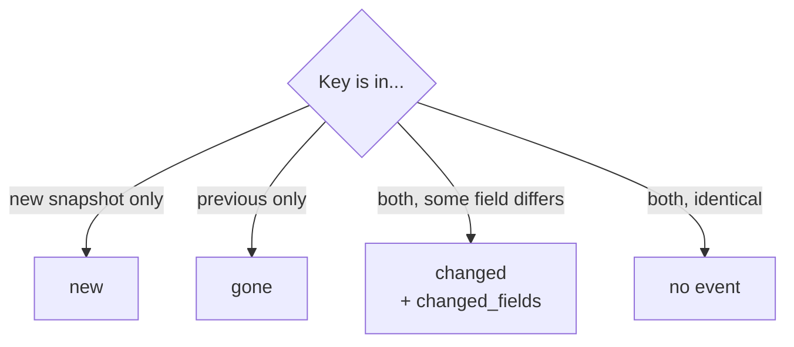
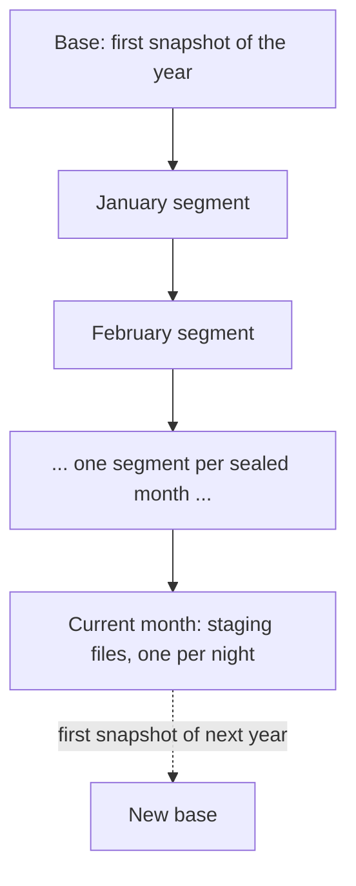
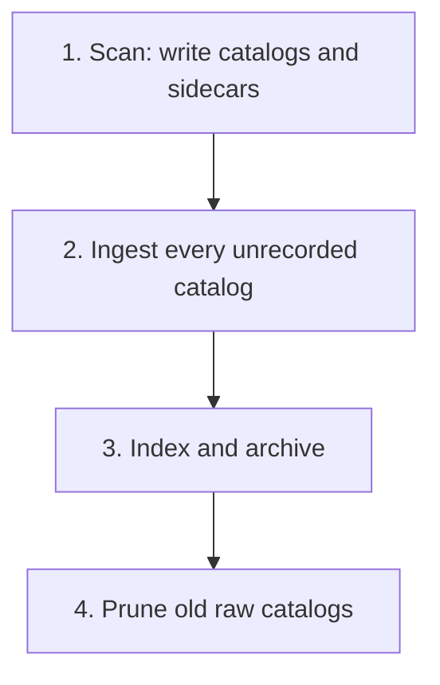
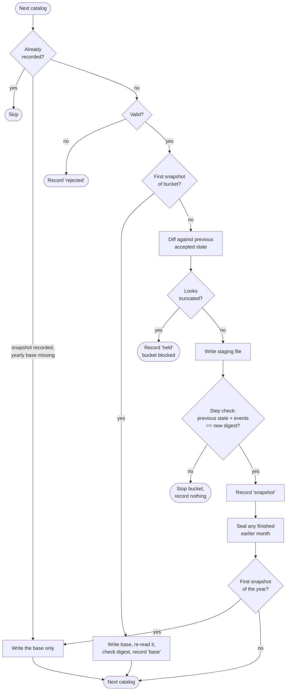
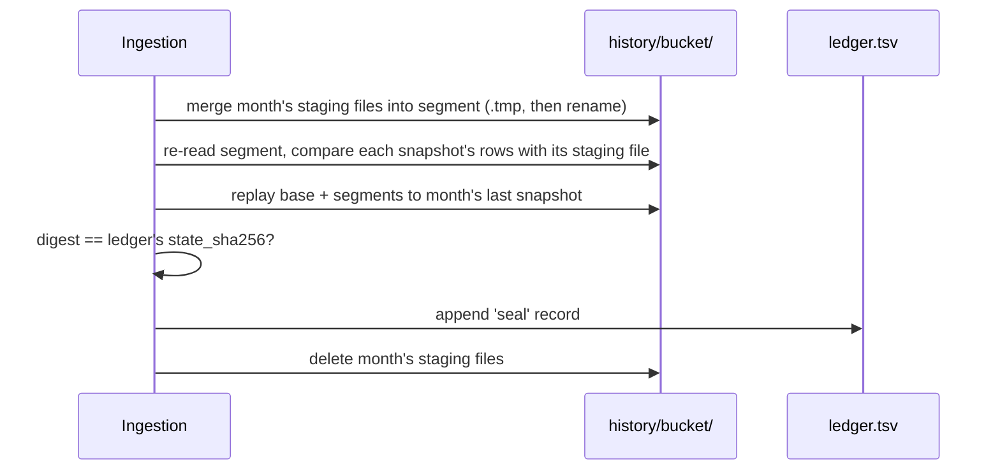
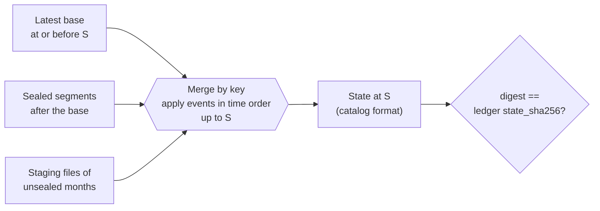
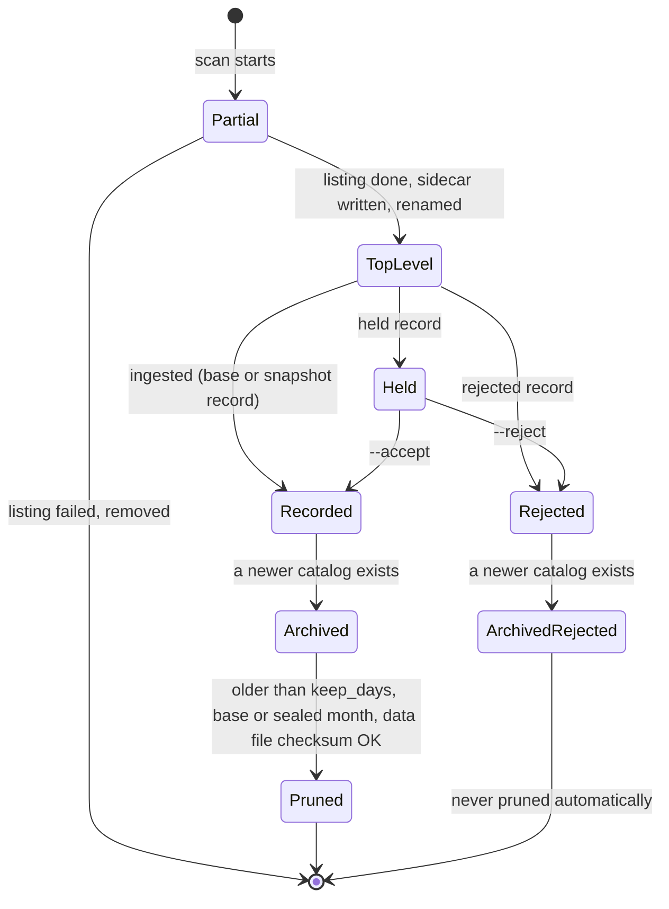

# S3 Bucket History — Overview

Status: companion to the draft spec, 2026-11-05.

This is an introduction to [`s3-history-spec.md`](s3-history-spec.md),
the design for a tool that turns nightly S3 bucket listings into a
compact, verifiable history. Read this first. Most questions about what
the tool does, and why, are answered here; the spec holds the exact
rules. **Where the two disagree, the spec is authoritative.** Section
links (→) point to the spec for detail.

Nothing described here exists yet. It is a design.

## Contents

1. [The problem](#the-problem)
2. [The idea in one picture](#the-idea-in-one-picture)
3. [Five principles](#five-principles)
4. [Vocabulary](#vocabulary)
5. [Events](#events)
6. [A worked example](#a-worked-example)
7. [What is on disk](#what-is-on-disk)
8. [The nightly run](#the-nightly-run)
9. [Holds, rejections, and stopped buckets](#holds-rejections-and-stopped-buckets)
10. [Sealing a month](#sealing-a-month)
11. [Reconstruction](#reconstruction)
12. [How the history stays trustworthy](#how-the-history-stays-trustworthy)
13. [The life of a raw catalog](#the-life-of-a-raw-catalog)
14. [Backfill: the existing archive](#backfill-the-existing-archive)
15. [Commands](#commands)
16. [Operator guide: problems and fixes](#operator-guide-problems-and-fixes)
17. [What the history cannot tell you](#what-the-history-cannot-tell-you)
18. [Reading the spec](#reading-the-spec)

## The problem

`aos-scan` lists every object in every bucket each night and writes one
gzipped TSV catalog per bucket. Old catalogs are moved to
`s3_objects/archive/` and kept. That archive is how we answer "what was
in this bucket last March?", but it is expensive:

- 1.7 TB in about 150,000 files, growing about 130 GiB per month, on a
  filesystem with 1.1 TB free (measured 2026-10-22).
- Three log and config buckets are 91% of it.
- Yet day-over-day, only 0.01–0.1% of rows change. Each night's catalog
  is almost entirely a copy of the previous night's.

Storing one full listing plus the daily differences takes a few GiB
instead of terabytes. → [Motivation](s3-history-spec.md#motivation)

## The idea in one picture



Each bucket gets its own history: one full **base** listing, then for
each later night only the **events** (what was added, changed, or
removed). Any past night's listing can be rebuilt by starting from the
base and applying events up to that night. Once the history provably
holds a night's content, the raw catalog for that night can be deleted.

## Five principles

1. **The history is the source of truth.** Every accepted listing can be
   reconstructed exactly. Query formats (search indexes, Parquet) are
   derived from it and can be rebuilt.
2. **Data files are never modified in place.** They are written once,
   under a temporary name, then renamed. The per-bucket ledger is only
   appended to, apart from removing a torn final line that was never
   acknowledged.
3. **Every step is proven before it counts.** After writing a night's
   events, the tool re-reads them from disk, applies them to the
   previous state, and checks that the result hashes to the new
   listing's digest. Only then does it record the night.
4. **Suspicious listings are held, not trusted.** A listing that lost
   many rows, or lost the end of its key range, may be a truncated
   listing rather than a mass deletion. It waits for an operator instead
   of writing thousands of false deletions.
5. **Raw data is deleted only when provably redundant.** Pruning needs a
   base, or a snapshot in a month that has been sealed (and so checked
   again against the segment that replaced its staging file), and an
   intact data file.

## Vocabulary

| Term | Meaning |
|---|---|
| **Catalog** / **snapshot** | One `aos-scan` listing of one bucket: a `.tsv.gz` file. |
| **Sidecar** | `NAME.meta.json` beside a new-style catalog: bucket, start and end time, row count, `complete: true`. Old catalogs have none. |
| **Series** | All snapshots of one bucket, in time order. The history is kept per series. |
| **`snapshot_at`** | When the listing started, in UTC. Identifies a snapshot within its series. |
| **State** | The normalized rows of a snapshot, sorted by key. |
| **Base** | A file holding a full state. Written for a bucket's first snapshot and again each January. |
| **Staging file** | The events of one snapshot, written nightly. |
| **Segment** | One month's staging files merged into one file, once the month is over ("sealed"). |
| **Ledger** | `ledger.tsv`, the per-bucket append-only index. A data file is part of the history only if a ledger record names it. |
| **`state_sha256`** | A digest of a state. Lets anyone check a reconstruction without keeping the original catalog. |
| **Accepted** | A snapshot with a `base` or `snapshot` ledger record. Only accepted snapshots can be reconstructed. |

## Events

Each accepted snapshot is compared, key by key, with the previous
accepted one:



Two more row types appear only in bases:

- **`initial`**: every key in a bucket's first snapshot. It means "start
  of tracking", so a real wave of uploads (`new`) can be told apart from
  the day we started watching.
- **`present`**: every key in a later base (yearly, or after a
  `rebase`). It restates a key already tracked; it is not an event.

Each row carries the listing fields: `last_modified`, `size`,
`storage_class`, `e_tag`, `checksum_algorithm`, `checksum_type`. A
`changed` row holds the new values and names the fields that differ;
the old values are in an earlier row. Some useful readings of
`changed_fields`:

| Fields that differ | Most likely |
|---|---|
| `last_modified`, `e_tag` (often `size`) | File overwritten with new content |
| `storage_class` only | Lifecycle rule moved it, e.g. to Glacier |
| `storage_class`, `last_modified` | Someone changed its class by copying it onto itself |
| `last_modified` only | Same bytes rewritten |

Before comparing, rows are **normalized** so that formatting noise does
not show up as changes: `last_modified` becomes UTC whole seconds,
quotes are stripped from `e_tag`, and so on.
→ [Events](s3-history-spec.md#events),
[Normalization](s3-history-spec.md#normalization)

## A worked example

A toy bucket, `demo-bucket`, followed through one month. To keep it
small, the example uses `max_drop_rows = 1` instead of the default
1,000 (see [Configuration](s3-history-spec.md#configuration)), and
shows only some columns.

### Oct 1: the first snapshot becomes a base

The listing has three objects. Because it is the bucket's first
snapshot, the whole state is written as a base:

```
history/demo-bucket/demo-bucket.base.20261001T080000Z.tsv.gz

event    snapshot_at           key     size  storage_class
initial  2026-10-01T08:00:00Z  a.txt   10    STANDARD
initial  2026-10-01T08:00:00Z  b.bam   500   STANDARD
initial  2026-10-01T08:00:00Z  c.vcf   70    STANDARD
```

### Oct 2: one upload, one lifecycle transition

`d.fq` was uploaded, and a lifecycle rule moved `b.bam` to Glacier. The
night's events go into a staging file:

```
history/demo-bucket/staging/demo-bucket.20261002T080000Z.events.tsv.gz

event    snapshot_at           prev_snapshot_at      key    size  storage_class  changed_fields
changed  2026-10-02T08:00:00Z  2026-10-01T08:00:00Z  b.bam  500   GLACIER        storage_class
new      2026-10-02T08:00:00Z  2026-10-01T08:00:00Z  d.fq   40    STANDARD
```

### Oct 3: nothing changed

No events, so no staging file. The ledger still gets a `snapshot`
record with an empty `file`, so a quiet day can be told apart from a
missed one.

### Oct 4: a listing that looks truncated is held

The listing came back with only `a.txt` and `b.bam`. Rows fell from 4
to 2: more than 10%, and more than `max_drop_rows`. Also, the last key
(`b.bam`) is earlier than before (`d.fq`), the signature of a listing
that stopped partway. The snapshot is **held**: nothing is recorded but
a `held` line in the ledger, and the bucket is **blocked**.

### Oct 5: the bucket stays blocked

The Oct 5 catalog arrives but is not ingested; nightly runs skip a
blocked bucket and report it. An operator investigates, decides the
Oct 4 listing was bad, and runs:

```
aos-history ingest --reject demo-bucket 2026-10-04T08:00:00Z
```

The next run ingests Oct 5, diffing it against **Oct 3**, the last
accepted snapshot. In the meantime `c.vcf` really was deleted:

```
event  snapshot_at           prev_snapshot_at      key
gone   2026-10-05T08:00:00Z  2026-10-03T08:00:00Z  c.vcf
```

(Losing one row of four is 25%, but not more than `max_drop_rows = 1`,
so this is not held.)

### The ledger so far

Simplified; the real ledger has more columns, including checksums and a
CRC per line:

```
record    snapshot_at           prev_snapshot_at      file                                   n_new n_changed n_gone note
base      2026-10-01T08:00:00Z                        demo-bucket.base.20261001T080000Z...
snapshot  2026-10-02T08:00:00Z  2026-10-01T08:00:00Z  staging/demo-bucket.20261002T...      1     1         0
snapshot  2026-10-03T08:00:00Z  2026-10-02T08:00:00Z                                         0     0         0
held      2026-10-04T08:00:00Z                                                                                  last key earlier; 2 of 4 rows lost
rejected  2026-10-04T08:00:00Z                                                                                  operator: truncated listing
snapshot  2026-10-05T08:00:00Z  2026-10-03T08:00:00Z  staging/demo-bucket.20261005T...      0     0         1
```

### Nov 1: October is sealed

The first November snapshot is ingested normally. Then, because a later
month has arrived, October is **sealed**: its staging files are merged
into one segment sorted by key, checked, recorded with a `seal` line,
and the staging files are deleted.

```
history/demo-bucket/demo-bucket.2026-10.events.tsv.gz

event    snapshot_at           key
changed  2026-10-02T08:00:00Z  b.bam
gone     2026-10-05T08:00:00Z  c.vcf
new      2026-10-02T08:00:00Z  d.fq
```

### Asking about the past

`aos-history as-of demo-bucket 2026-10-04` finds the last accepted
snapshot on or before that date. A bare date means the end of that day
in Chicago time, so the day's own snapshot counts; but Oct 4 was
rejected, so the answer is Oct 3, rebuilt from the base plus events up
to Oct 3:

```
a.txt  10   STANDARD
b.bam  500  GLACIER
c.vcf  70   STANDARD
d.fq   40   STANDARD
```

`aos-history log demo-bucket c.vcf` prints `c.vcf`'s rows in time
order: `initial` on Oct 1, `gone` on Oct 5.

## What is on disk

```
s3_objects/
├── 20261101-031502-demo-bucket.tsv.gz       raw catalogs (local time in name)
├── 20261101-031502-demo-bucket.meta.json    their sidecars
├── archive/YYYY/MM/DD/...                   older raw catalogs
├── archive/rejected/...                     rejected catalogs, kept for review
└── history/
    ├── FORMAT                               "aos-history 1"
    └── demo-bucket/
        ├── .lock                            per-bucket lock
        ├── ledger.tsv                       append-only index
        ├── demo-bucket.base.20261001T080000Z.tsv.gz
        ├── demo-bucket.2026-10.events.tsv.gz      sealed segment
        └── staging/
            └── demo-bucket.20261101T091502Z.events.tsv.gz
```

All data files (base, staging, segment) share one format: gzipped TSV
with a header, the same columns, `\n` line endings, sorted by key.
Every file name includes the bucket, so a stray copy still identifies
itself. → [Storage layout](s3-history-spec.md#storage-layout)

Over a year, one bucket's history looks like this:



A new base each January bounds any reconstruction to one base plus at
most twelve segments (plus the current month's staging files).

Why sort segments by key rather than by time? So that rebuilding a
state is a single merge of sorted files, one open stream per file, in
constant memory, even for an 85-million-row bucket.

## The nightly run

`aos-scan` gains an ingestion step. Production runs it twice into one
output root, once per AWS account; the first run skips indexing.



Flags turn steps off: `--no-scan`, `--no-history`, `--no-index`,
`--no-prune`. Pruning runs only in a run that indexed.

### Scanner changes come first

Today a failed listing can leave a truncated catalog that looks normal.
Before ingestion is turned on, the scanner must:

- write to `NAME.tsv.gz.partial`, then write the sidecar, then rename
  the catalog to its final name, so a final name always means a
  finished listing with a sidecar;
- on a failure, log it, drop the partial file, and continue with the
  next bucket (a credential error still ends the run), exiting non-zero
  at the end;
- stop stripping quotes from every field; only `ETag` should lose them.

→ [Prerequisite: scanner changes](s3-history-spec.md#prerequisite-scanner-changes)

### Ingesting one catalog

For each bucket, unrecorded catalogs are taken oldest first. A bucket
that is held, awaiting backfill, or locked by another process is
skipped and reported.



**Validation** rejects a catalog if its sidecar does not say
`complete`, the gzip stream is damaged, the header or row count is
wrong, keys are not strictly increasing, the bucket does not match, or
its time is not after the last accepted snapshot (or falls in an
already-sealed month).

**The previous state** comes from the previous raw catalog when it is
still on disk (normally, since raw catalogs are kept at least 14 days), or is
reconstructed from the history otherwise. Either way its digest must
match the ledger, or the bucket stops.

**The step check** is the key safety step: it reads the staging file
back from disk and proves that previous state plus stored events
equals the new snapshot. For the largest bucket it costs a second read
of a ~3 GiB catalog per night.
→ [Ingestion](s3-history-spec.md#ingestion)

## Holds, rejections, and stopped buckets

Three different ways a snapshot can fail to be accepted:

| | Rejected | Held | Stopped |
|---|---|---|---|
| Cause | Failed validation (incomplete, malformed, out of order) | Valid, but lost too many rows or the tail of its keys | A digest did not match: the raw file or the history disagrees with the ledger |
| Ledger | `rejected` record | `held` record | Nothing |
| Effect on bucket | None; the next snapshot diffs across the gap | **Blocked**: later catalogs wait | **Stopped** every run until fixed |
| Resolved by | Nothing needed; review the catalog in `archive/rejected/` | `aos-history ingest --accept` or `--reject BUCKET SNAPSHOT_AT` | An operator investigates |

A hold triggers when, versus the previous accepted snapshot, either:

- rows fell by more than 10% **and** more than 1,000, or
- the last key is earlier than before **and** more than 1,000 keys past
  it are gone. This catches truncation of a huge bucket, where even
  millions of lost rows are under 10%.

The 1,000-row floor keeps small buckets that are emptied on purpose from
being held. `--accept` redoes the diff and the step check, skipping only
the hold test. Thresholds are set in the configuration file or on the
command line, but changing them never releases an existing hold.

A stopped or held bucket affects only itself: other buckets are
ingested, and indexing and pruning still run. A stopped bucket makes
`aos-scan` exit non-zero so cron reports it; a held bucket is reported
in each run's output but is not an error, since a large drop may be a
deliberate cleanup.

## Sealing a month

Daily staging files are small and numerous. When a snapshot from a new
month is ingested, each earlier unsealed month is sealed:



The replay check reads the new segment in place of the staging files,
so the segment is verified before it replaces them. If a check fails,
nothing is recorded, the staging files stay, and the bucket stops.

A bucket that stops being scanned (deleted, or excluded in the
configuration) never gets a next-month snapshot, so its last month is
never sealed automatically. `status` reports such a series as **ended**,
and `aos-history seal BUCKET` seals it. `seal` refuses a blocked series,
because once a month is sealed, its unrecorded catalogs could never be
accepted. → [Sealing a month](s3-history-spec.md#sealing-a-month)

## Reconstruction

To rebuild the state at accepted snapshot S:



`new` and `changed` set a key's row; `gone` removes it. Every input is
sorted by key, so one pass over all files suffices. The output is in
catalog format: a drop-in replacement for the archived catalog, usable
with `zgrep`. → [Reconstruction](s3-history-spec.md#reconstruction)

## How the history stays trustworthy

### Layers of checking

| Check | When | What it proves |
|---|---|---|
| Base re-read | Every base write | The base on disk hashes to the snapshot's digest |
| Step check | Every snapshot | Previous state + stored events = this snapshot |
| Seal replay | Every month | The new segment, and the chain from the base, reproduce the month's last snapshot |
| `aos-history verify` | On demand; before pruning the backfilled archive | Ledger CRCs, every data file checksum, segment counts, and replays at every sealed month and the latest snapshot |

Because every step is checked, every accepted snapshot is reproducible
by induction from its base.

### Write discipline

Every file is written as `NAME.tmp`, fsynced, renamed, and its directory
fsynced. A data file is durable before the ledger record that names it.
So a file not named by the ledger is leftover from an interrupted run,
and is ignored; a rerun replaces it, or `aos-history verify --clean`
removes it.

Ledger lines are each appended in one write and carry a CRC. A final
line without a newline is a torn append from a crash: readers ignore
it, and the next writer removes it. Any other bad line is treated as
corruption, and the tool stops.
→ [Ledger](s3-history-spec.md#ledger),
[Write discipline](s3-history-spec.md#write-discipline)

### Locking

Each bucket's `history/<bucket>/.lock` serializes work on that bucket;
different buckets proceed in parallel.

- Writers (ingestion, backfill, seal, prune, `clean`, `verify --clean`)
  take it exclusively. Nightly runs never wait: a locked bucket is
  skipped and picked up the next night.
- Readers (`as-of`, `log`, `verify`) take it shared, so a seal cannot
  delete staging files they are reading.
- `status` reads only the append-only ledger and takes no lock.

### Crashes

The design goal: a crash at any single write step either heals itself
on the next run or is reported by it for an admin to clear.

| Crash during | Leaves | Next run |
|---|---|---|
| A scan | A `.partial` catalog, or a sidecar without catalog | Ignored; reported; admin runs `aos-history clean` |
| Writing a staging file or base | An unreferenced file | Rewritten by the rerun |
| Between the `snapshot` record and the yearly base | A snapshot without its base | Writes only the base |
| A seal, before the `seal` record | An unreferenced segment | Seal reruns and replaces it |
| A seal, after the `seal` record | Staging files of a sealed month | Deleted automatically |
| A ledger append | A torn last line | Ignored, then truncated before the next append |
| Archiving or pruning a catalog and its sidecar | Sidecar separated from catalog | Archiving finishes the move; pruning's orphan is removed by `clean` |

## The life of a raw catalog



(Ingestion also reads catalogs that were already archived, since the
first run of the night archives nothing. The diagram shows the usual
order.)

A raw catalog is pruned only once it is at least `keep_days` old (14
by default) and either has a `base` record or its month is sealed.
Catalogs from early in a month are therefore kept about a month, and those from
late in a month 14 days; at peak, about one month of catalogs is on
disk. If a seal fails, every catalog of that month without a `base`
record is still there. The
nightly diff normally reads two raw files and never needs a
reconstruction.
→ [Pruning raw snapshots](s3-history-spec.md#pruning-raw-snapshots)

## Backfill: the existing archive

The 1.7 TB archive predates sidecars. `aos-history backfill
[BUCKET...]` feeds those catalogs, oldest first, through the same code
path, with these differences:

- The time comes from the file name (America/Chicago local time,
  converted to UTC), and the completion time from the file's mtime.
- Completeness cannot be proven, so the header, key-order, and hold
  checks stand in.
- A bucket with a key wrapped in double quotes, such as `"x"`, may fail the
  key-order check in every old catalog, because the old scanner
  stripped those quotes. It gets no backfilled history, and its
  catalogs are kept. If the stripped key stays in order, backfill
  records it without quotes, and the first new-style snapshot shows it
  as `gone` plus `new`.

Nightly ingestion runs alongside: it skips a bucket that still has
unrecorded catalogs without sidecars, or that backfill has locked. Buckets can be
backfilled in parallel. Nightly pruning never touches catalogs without
sidecars. Once backfill is done, `aos-history prune --backfilled`
verifies each bucket end to end and only then deletes its old,
recorded catalogs. No separate copy of the archive is kept.
→ [Backfill](s3-history-spec.md#backfill)

## Commands

| Command | Purpose |
|---|---|
| `aos-scan` | Scan, ingest, index and archive, prune (each step can be turned off) |
| `aos-history ingest` | Ingest unrecorded catalogs without scanning |
| `aos-history ingest --accept/--reject BUCKET SNAPSHOT_AT` | Resolve a held snapshot |
| `aos-history backfill [BUCKET...]` | Ingest the old, sidecar-less archive |
| `aos-history seal BUCKET` | Seal the last months of an ended series |
| `aos-history rebase BUCKET` | Start a fresh chain from the next catalog when earlier history is damaged |
| `aos-history verify [BUCKET...] [--clean]` | End-to-end check; `--clean` removes leftover files |
| `aos-history prune [--backfilled]` | Delete raw catalogs whose content is in the history |
| `aos-history as-of BUCKET DATE [-o FILE]` | Rebuild a bucket's listing as of a date (a bare date includes that day's snapshot) |
| `aos-history log BUCKET [KEY_OR_PREFIX]` | Show a key's or prefix's history |
| `aos-history status [BUCKET...]` | Per-bucket summary and problems |
| `aos-history clean` | Remove stale `.partial` files and orphaned sidecars |

Later, an "ever seen" index behind `search-aws --history` would answer
"did this file ever exist, and where did it go?" with the search tool
users already know. → [Query support](s3-history-spec.md#query-support)

Per-bucket policy lives in an optional `aws-object-search.toml`:
`history_only` buckets (the big log and config buckets) are recorded
but not indexed; `exclude` buckets are not scanned at all.
→ [Configuration](s3-history-spec.md#configuration)

## Operator guide: problems and fixes

Problems show up in `aos-history status`, in the output of nightly runs
(which exit non-zero when a bucket failed or stopped), or both.

| Reported | Meaning | What to do |
|---|---|---|
| **Held** / **blocked** | A snapshot lost too many rows or its key tail; later catalogs wait | Compare it with the previous catalog; `aos-history ingest --accept` or `--reject BUCKET SNAPSHOT_AT` |
| **Stopped** (digest mismatch, failed step or seal check) | The raw catalog or the history no longer matches the ledger | Investigate; nothing was recorded. If the history is damaged, `aos-history rebase BUCKET` starts a fresh chain |
| **Rejected** | A catalog failed validation | Review it in `archive/rejected/`; the bucket continues without it |
| **Awaiting backfill** | The bucket has old catalogs without sidecars | Run `aos-history backfill BUCKET` |
| **Ended** | No snapshots since a month that has finished | `aos-history seal BUCKET` |
| **Stale `.partial` files / orphaned sidecars** | Left by a crashed scan or prune | Once no scan is running, `aos-history clean` |
| **Locked, skipped** | Another process held the bucket | Nothing; it is picked up next run |
| **Gaps** | Nights with no accepted snapshot | Usually rejected or failed scans; check the scan logs |

## What the history cannot tell you

The history records the differences between nightly listings, not every
change in S3:

- Several overwrites in one day show as one `changed`; a delete and
  re-upload as `changed`; an object created and deleted within a day
  not at all.
- A rename shows as `gone` plus `new`. (S3 has no rename.)
- A `gone` is known only to have happened between two listings.
- Tags, metadata, ACLs, and Glacier restore status are invisible unless
  the object is rewritten.
- In versioned buckets, only current versions are recorded.

Out of scope for v1: rename detection, anything beyond the listing,
S3 event notifications, off-site copies of `history/`, and prefix-level
series. → [Known limits](s3-history-spec.md#known-limits),
[Non-goals](s3-history-spec.md#non-goals-v1)

## Reading the spec

When this overview is not enough, the spec in a sensible order:

1. [Goals](s3-history-spec.md#goals), [Terms](s3-history-spec.md#terms),
   [Events](s3-history-spec.md#events), and the
   [Core invariant](s3-history-spec.md#core-invariant): what must
   always be true.
2. [Storage layout](s3-history-spec.md#storage-layout): exact columns,
   row order, normalization, the ledger's columns and records, and the
   [State digest](s3-history-spec.md#state-digest) encoding.
3. [Write discipline](s3-history-spec.md#write-discipline): fsync
   order and locking, including why a process never re-opens a lock it
   holds (NFS).
4. [Ingestion](s3-history-spec.md#ingestion) and
   [Sealing a month](s3-history-spec.md#sealing-a-month): the
   step-by-step rules, including crash recovery.
5. [Reconstruction](s3-history-spec.md#reconstruction),
   [Verification](s3-history-spec.md#verification),
   [Pruning](s3-history-spec.md#pruning-raw-snapshots), and
   [Backfill](s3-history-spec.md#backfill).
6. [Prerequisite: scanner changes](s3-history-spec.md#prerequisite-scanner-changes):
   needed before any of it runs.
7. [Decisions](s3-history-spec.md#decisions): what was settled, and
   why.
